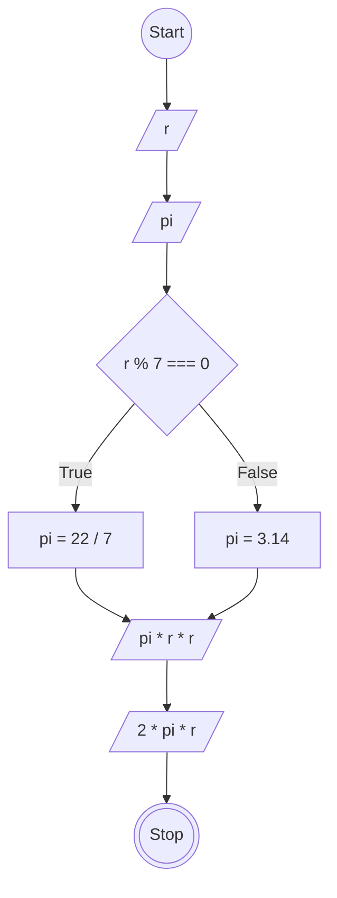

# JavaScript 1

## Membuat Program Hitung Luas dan Keliling Lingkaran

### Flowchart


### Penjelasan
```
// Membuat objek hitungLingkaran
const hitungLingkaran = {
  r: 7,
  pi: 0,
  //Membuat method hitung untuk menghitung luas dan keliling lingkaran.
  hitung: function() {
    let pi;
    /*
    Menentukan nilai pi menggunakan pengondisian:
    - Jika r habis dibagi 7, pi bernilai 22/7.
    - Jika tidak, pi bernilai 3.14.
    */
    if (this.r % 7 === 0) {
      pi = 22 / 7;
    } else {
      pi = 3.14;
    }
    
    // Menghitung luas lingkaran menggunakan rumus pi * r * r
    const luasLingkaran = pi * this.r * this.r;

    // Menghitung keliling lingkaran menggunakan rumus pi * r * 2
    const kelilingLingkaran = pi * this.r * 2;

    // Mengembalikan hasil luas dan keliling dalam bentuk objek
    return { luasLingkaran, kelilingLingkaran };
  }
};

// Memanggil method hitung dan menyimpan hasilnya ke variabel result
const result = hitungLingkaran.hitung();

// Menampilkan hasil luas lingkaran ke console
console.log(result.luasLingkaran);

// Menampilkan hasil keliling lingkaran ke console
console.log(result.kelilingLingkaran);
```