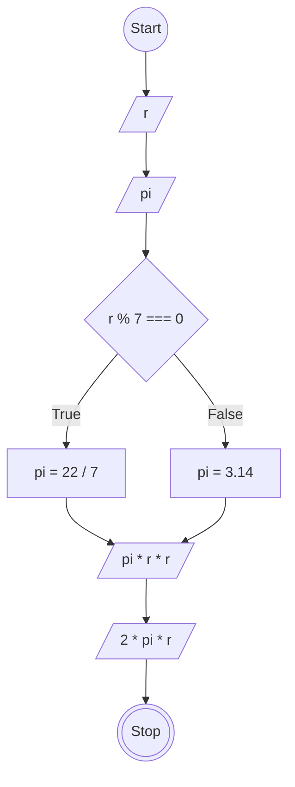

# JavaScript 1

## Membuat Program Hitung Luas dan Keliling Lingkaran

### Flowchart


### Penjelasan
```
/*
Membuat objek hitungLingkaran
*/
const hitungLingkaran = {
  r: 7,
  pi: 0,

  /*
  Membuat method tentukanPi dengan pengondisian:
  - Jika r habis dibagi 7, pi bernilai 22/7.
  - Jika tidak, pi bernilai 3.14.
  */
  tentukanPi: function() {
    if (this.r % 7 === 0) {
      this.pi = 22 / 7;
    } else {
      this.pi = 3.14;
    }
  },

  // Membuat method luasLingkaran untuk menghitung dan mengembalikan luas lingkaran
  luasLingkaran: function() {
    return this.pi * this.r * this.r;
  },

  // Membuat method kelilingLingkaran untuk menghitung dan mengembalikan keliling lingkaran
  kelilingLingkaran: function() {
    return this.pi * this.r * 2;
  }
};

// Memanggil method tentukanPi untuk menentukan nilai pi
hitungLingkaran.tentukanPi();

// Memanggil method luasLingkaran dan menyimpan nilai hasilnya ke const luasLingkaran
const luasLingkaran = hitungLingkaran.luasLingkaran();

// Memanggil method kelilingLingkaran dan menyimpan nilai hasilnya ke const kelilingLingkaran
const kelilingLingkaran = hitungLingkaran.kelilingLingkaran();

// Menampilkan nilai luas dan keliling lingkaran ke console
console.log(luasLingkaran);
console.log(kelilingLingkaran);
```