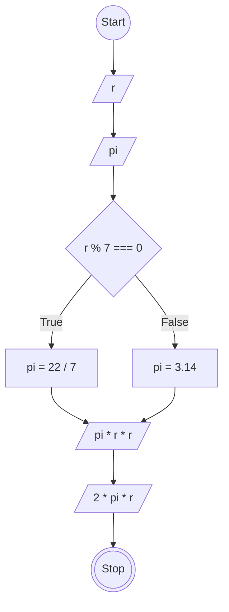

# JavaScript 1

## Membuat Program Hitung Luas dan Keliling Lingkaran

### Flowchart


### Penjelasan Kode
```
// Membuat objek hitungLingkaran
const hitungLingkaran = {
  r: 7, // Menentukan jari-jari lingkaran
  pi: 0, // Inisialisasi nilai pi

  // Menentukan nilai pi menggunakan if...else
  tentukanPi: function() {
    if (this.r % 7 === 0) {
      this.pi = 22 / 7;
    } else {
      this.pi = 3.14;
    }
  },

  // Menghitung luas dan mengirim hasilnya ke callback
  luasLingkaran: function(callback) {
    hitungLingkaran.tentukanPi();
    const luas = this.pi * this.r * this.r;
    callback(luas); // Memanggil callback dengan hasil luas
  },

  // Menghitung keliling dan mengirim hasilnya ke callback
  kelilingLingkaran: function(callback) {
    hitungLingkaran.tentukanPi();
    const keliling = this.pi * this.r * 2;
    callback(keliling); // Memanggil callback dengan hasil keliling
  }
};

// Memanggil method luasLingkaran dengan callback untuk mencetak hasil
hitungLingkaran.luasLingkaran(function(luasLingkaran) {
  console.log(luasLingkaran);
});

// Memanggil method kelilingLingkaran dengan callback untuk mencetak hasil
hitungLingkaran.kelilingLingkaran(function(kelilingLingkaran) {
  console.log(kelilingLingkaran);
});
```