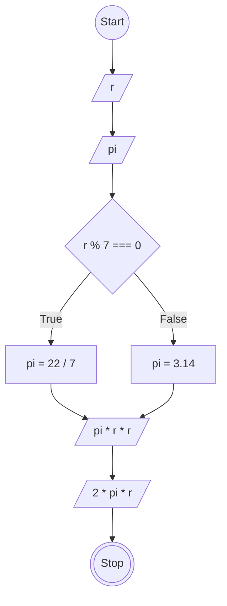

# JavaScript 1

## Membuat Program Hitung Luas dan Keliling Lingkaran

### Flowchart


### Penjelasan Kode
```
// Membuat objek lingkaran untuk menyimpan jari-jari dan nilai pi
const lingkaran = {
  r: 7,
  pi: 0
};

// Menentukan nilai pi berdasarkan jari-jari menggunakan if...else
function menentukanPi() {
  if (lingkaran.r % 7 === 0) {
    lingkaran.pi = 22 / 7;
  } else {
    lingkaran.pi = 3.14;
  }
}

// Menghitung luas lingkaran dan mengirim hasilnya melalui callback
function luasLingkaran(callback) {
  menentukanPi();
  const luas = lingkaran.pi * lingkaran.r * lingkaran.r;
  callback(luas);
}

// Menghitung keliling lingkaran dan mengirim hasilnya melalui callback
function kelilingLingkaran(callback) {
  menentukanPi();
  const keliling = lingkaran.pi * lingkaran.r * 2;
  callback(keliling);
}

// Memanggil fungsi luasLingkaran dengan callback untuk menampilkan hasil
luasLingkaran(function(luas) {
  console.log(luas);
});

// Memanggil fungsi kelilingLingkaran dengan callback untuk menampilkan hasil
kelilingLingkaran(function(keliling) {
  console.log(keliling);
});
```