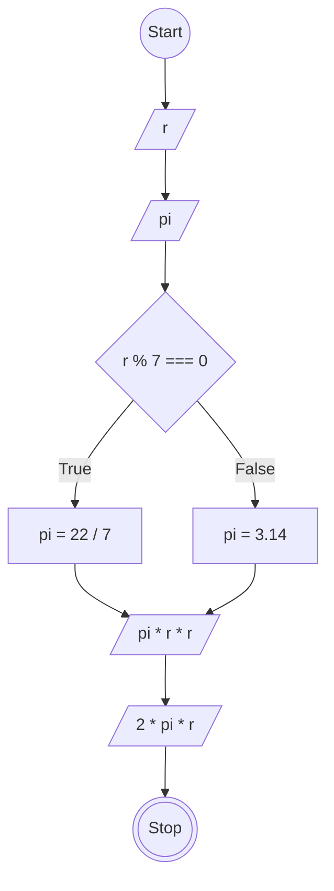

# JavaScript 1

## Membuat Program Hitung Luas dan Keliling Lingkaran

### Flowchart


### Penjelasan Kode
```
// Membuat objek hitungLingkaran
const hitungLingkaran = {
  // Menentukan jari-jari lingkaran
  r: 7,

  // Menentukan nilai awal pi
  pi: 0,

  // Membuat method untuk menentukan nilai pi
  tentukanPi: function() {
    // Memeriksa apakah jari-jari habis dibagi 7
    if (this.r % 7 === 0) {
      // Jika benar, pi menggunakan 22/7
      this.pi = 22 / 7;
    } else {
      // Jika salah, pi menggunakan 3.14
      this.pi = 3.14;
    }
  },

  // Membuat method untuk menghitung luas lingkaran
  luasLingkaran: function() {
    // Memanggil method tentukanPi untuk menentukan nilai pi
    hitungLingkaran.tentukanPi();

    // Menghitung luas dengan rumus pi * r * r
    return this.pi * this.r * this.r;
  },

  // Membuat method untuk menghitung keliling lingkaran
  kelilingLingkaran: function() {
    // Memanggil method tentukanPi untuk menentukan nilai pi
    hitungLingkaran.tentukanPi();

    // Menghitung keliling dengan rumus pi * r * 2
    return this.pi * this.r * 2;
  }
};

// Memanggil method luasLingkaran dan menyimpan hasilnya
const luasLingkaran = hitungLingkaran.luasLingkaran();

// Memanggil method kelilingLingkaran dan menyimpan hasilnya
const kelilingLingkaran = hitungLingkaran.kelilingLingkaran();

// Menampilkan hasil luas lingkaran ke console
console.log(luasLingkaran);

// Menampilkan hasil keliling lingkaran ke console
console.log(kelilingLingkaran);
```