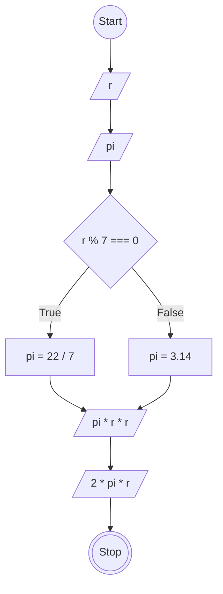

# JavaScript 1

## Membuat Program Hitung Luas dan Keliling Lingkaran

### Flowchart


### Penjelasan
```
// Membuat method hitungLingkaran
const hitungLingkaran = {
  r: 7,
  pi: 0,
  /*
  Membuat method tentukanPi dengan pengondisian:
  - jika r modulus 7 sama dengan 0 maka pi adalah 22/7
  - jika r modulus 7 tidak sama dengan 0 maka pi adalah 3.14
  */
  tentukanPi: function() {
    if (this.r % 7 === 0) {
      this.pi = 22 / 7;
    } else {
      this.pi = 3.14;
    }
  },
  // Membuat function rumus luas lingkaran dan mengembalikan nilai ke method luasLingkaran
  luasLingkaran: function() {
    return this.pi * this.r * this.r;
  },
  // Membuat function rumus keliling lingkaran dan mengembalikan nilai ke method kelilingLingkaran
  kelilingLingkaran: function() {
    return this.pi * this.r * 2;
  }
};

// Memanggil method tentukanPi
hitungLingkaran.tentukanPi();

// Destructuring method ke dalam const
const luasLingkaran = hitungLingkaran.luasLingkaran();
const kelilingLingkaran = hitungLingkaran.kelilingLingkaran();

// Mencetak nilai luasLingkaran dan kelilingLingkaran
console.log(luasLingkaran);
console.log(kelilingLingkaran);
```